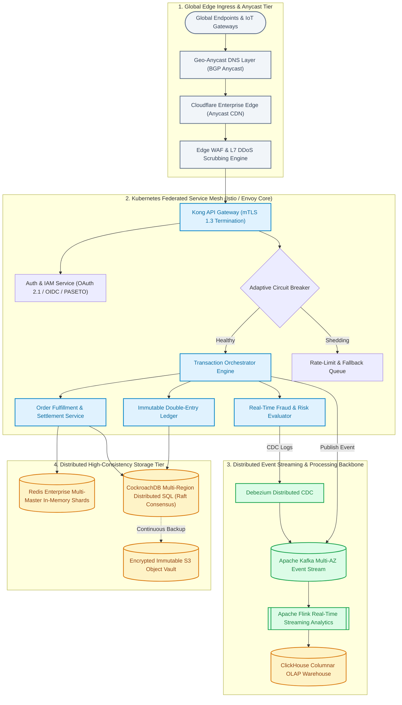
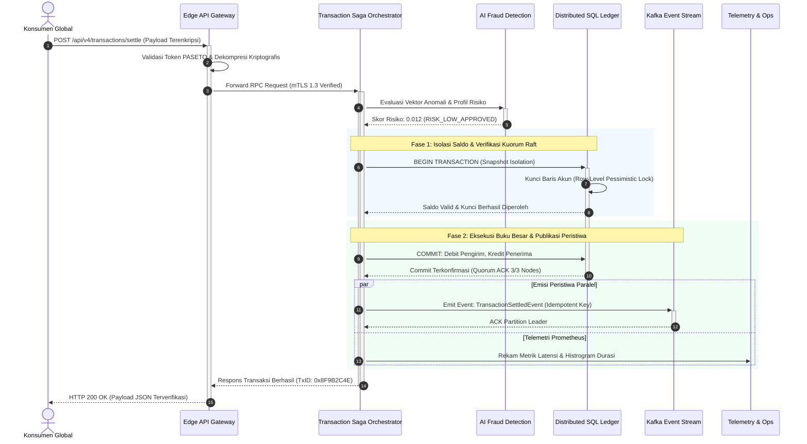
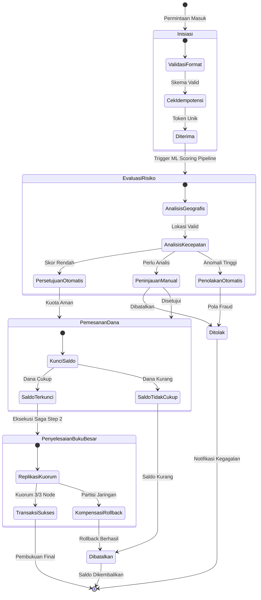
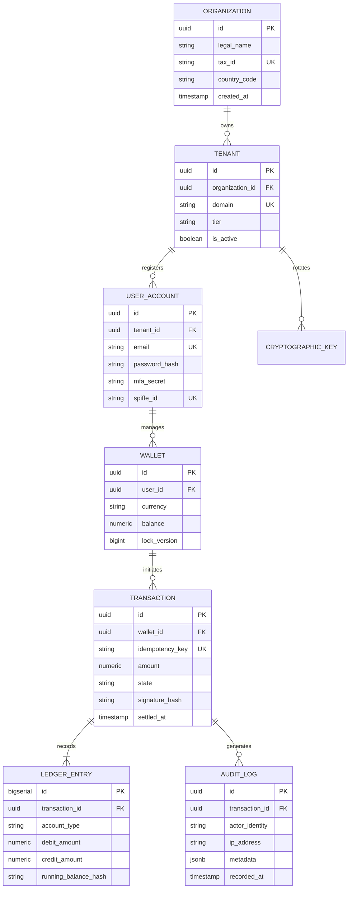
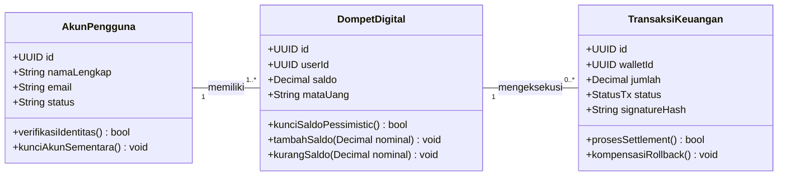

# Ringkasan Eksekutif & Mandat Rekayasa

Dokumen arsitektur teknis ini merumuskan cetak biru rekayasa perangkat lunak skala enterprise untuk sistem terdistribusi generasi masa depan (*Next-Generation Distributed Cloud Mesh*). Arsitektur ini dirancang secara khusus untuk memenuhi mandat ketersediaan layanan ekstrem (*Five Nines Availability* - $99.999\%$), latensi komputasi persentil ke-99 ($p99$) di bawah $15\text{ ms}$, serta ketahanan penuh terhadap kegagalan partisi jaringan trans-benua (*Byzantine Fault Resilience*)[^1].

> [!NOTE]
> Spesifikasi teknis ini mencakup seluruh lapisan komputasi, mulai dari gerbang tepi (*Edge Anycast Layer*), kluster *service mesh* Kubernetes terfederasi, hingga mesin persistensi data terdistribusi multi-region dengan replikasi sinkron.

Dalam era ekonomi digital berskala petabyte, keandalan sistem bukan lagi sekadar sasaran operasional, melainkan fondasi integritas transaksi keuangan global. Dokumen ini menjadi pedoman baku bagi seluruh tim rekayasa platform, arsitek keamanan, dan teknisi SRE (*Site Reliability Engineering*).

> [!IMPORTANT]
> Setiap komponen perangkat lunak yang didefinisikan dalam dokumen ini wajib melalui tahapan verifikasi model formal (*TLA+ specification*) dan simulasi kekacauan beban (*Chaos Engineering*) sebelum disetujui untuk penerapan tingkat produksi.

---

# Landasan Desain & Matriks Prinsip Komputasi

Pembangunan infrastruktur berpijak pada modularitas tinggi, komunikasi asinkron berbasis *event-driven architecture*, serta kepatuhan mutlak terhadap arsitektur nir-kepercayaan (*Zero Trust Architecture* - ZTA)[^2].

:::columns 3
:::col
### Prinsip Resiliensi
- **Multi-Region Active-Active**: Beban terdistribusi merata di 3 zona ketersediaan geografis (Asia, Eropa, dan Amerika).
- **Graceful Degradation**: Kegagalan subsistem periferal otomatis mengaktifkan mode operasi minimal (*fail-safe*).
- **Auto-Healing Daemon**: Pemulihan pod komputasi dalam waktu $\Delta t \le 3\text{ detik}$.
:::
:::col
### Prinsip Keamanan
- **Strict mTLS 1.3**: Setiap percakapan antar-layanan terenkripsi dengan sertifikat berumur pendek (*short-lived*).
- **SPIFFE / SPIRE Workload ID**: Identitas kriptografis unik berbasis perangkat keras (TPM 2.0).
- **Immutable Audit Trail**: Seluruh jejak audit dicatat ke penyimpanan *write-once-read-many* (WORM).
:::
:::col
### Prinsip Kinerja
- **Kernel Bypass Networking**: Pemanfaatan eBPF dan XDP untuk perutean paket berkecepatan tinggi.
- **Zero-Copy Serialization**: Protokol FlatBuffers / Cap'n Proto pada jalur data kritis.
- **In-Memory Sharding**: Partisi data berbasis konsistensi hash dinamis (*consistent hashing ring*).
:::
:::

<!-- pagebreak -->

# Topologi Layanan & Arsitektur Global Multi-Cloud

Topologi sistem terdistribusi ini mengintegrasikan lapisan *Edge CDN*, orkestrasi kontainer terdistribusi, *event streaming backbone*, serta penyimpanan terdistribusi bertingkat (*hierarchical storage tiering*).



---

# Diagram Alur Transaksi & Protokol Konsensus (Sequence Diagram)

Diagram urutan berikut mendemonstrasikan protokol konsensus transaksi keuangan terdistribusi dua fase (*Two-Phase Commit / Saga Pattern*) yang melibatkan validasi risiko kecerdasan buatan, pemesanan saldo terisolasi, pencatatan buku besar ganda, dan penerbitan *event streaming* tanpa peluang terjadinya inkonsistensi data.



<!-- pagebreak -->

# Siklus Hidup Transaksi & Mesin Keadaan (State Diagram)

Setiap entitas transaksi di dalam sistem dikelola oleh mesin keadaan hingga (*Finite State Machine* / FSM) yang deterministik. Tidak ada transaksi yang diperkenankan berpindah keadaan tanpa bukti verifikasi kriptografis:



---

# Model Relasi Data & Skema Terdistribusi (ER Diagram)

Penyimpanan data transaksi dan kontrol otentikasi mematuhi normalisasi Boyce-Codd (BCNF) dengan partisi berbasis regional sharding:



<!-- pagebreak -->

# Spesifikasi Struktur Data & Domain Model (Diagram Tabel Kelas)

Diagram tabel berikut memodelkan entitas domain transaksi keuangan dengan atribut bertipe data kuat, batasan integritas relasional, serta metode kontrak bisnis:



### Kamus Data & Integritas Relasional Tabel

| Nama Entitas | Kunci Primer (PK) | Kunci Asing (FK) | Indeks Unik (UK) | Aturan Integritas |
| :--- | :--- | :--- | :--- | :--- |
| **AkunPengguna** | `id (UUID v4)` | — | `email` | Validasi RFC-5322 & SPIFFE ID |
| **DompetDigital** | `id (UUID v4)` | `userId` | `(userId, mataUang)` | Saldo Non-Negatif ($\ge 0$) |
| **TransaksiKeuangan** | `id (UUID v4)` | `walletId` | `idempotencyKey` | Tanda Tangan Kriptografi Ed25519 |

<!-- pagebreak -->

# Model Matematika Beban, Teori Antrean & Resiliensi

Kapasitas penanganan beban terdistribusi (*distributed system throughput*) dimodelkan menggunakan kerangka matematis Teori Antrean Kendali Poisson $M/M/c/K$ dengan kapasitas penyangga terhingga (*finite buffer*) untuk mencegah kehabisan memori (*Out-Of-Memory* / OOM crash)[^3].

### 1. Probabilitas Sistem Kosong & Teori Antrean Erlang-C

Probabilitas keadaan dasar di mana seluruh simpul pekerja dalam keadaan siaga ($P_0$) dinyatakan dalam persamaan:

$$
P_0 = \left[ \sum_{n=0}^{c-1} \frac{1}{n!} \left(\frac{\lambda}{\mu}\right)^n + \frac{1}{c!} \left(\frac{\lambda}{\mu}\right)^c \sum_{n=c}^{K} \left(\frac{\lambda}{c \cdot \mu}\right)^{n-c} \right]^{-1}
$$

Di mana:
- $\lambda$ melambangkan laju kedatangan permintaan per detik ($\text{req/s}$).
- $\mu$ melambangkan kapasitas pemrosesan per simpul pekerja per detik.
- $c$ adalah jumlah instans komputasi aktif ($c = 64\text{ pods}$).
- $K$ adalah batas maksimum antrean penyangga memori ($K = 250.000\text{ tasks}$).

### 2. Waktu Antrean Rata-Rata ($W_q$) & Faktor Utilisasi ($\rho$)

Faktor utilisasi sistem multi-prosesor $\rho$ didefinisikan sebagai:

$$
\rho = \frac{\lambda}{c \cdot \mu} < 1
$$

Rata-rata waktu tunggu paket permintaan dalam antrean sebelum memperoleh komputasi ($W_q$) diturunkan melalui persamaan:

$$
W_q = \frac{P_0 \left(\frac{\lambda}{\mu}\right)^c \rho}{c! \, (1 - \rho)^2 \, \lambda}
$$

Total waktu respons sistem dari perspektif klien ($W$) merupakan penjumlahan dari waktu tunggu dan waktu komputasi murni:

$$
W = W_q + \frac{1}{\mu}
$$

### 3. Matriks Transisi Keadaan Markov Chain

Perpindahan keadaan antrean mikro-layanan dimodelkan sebagai proses kelahiran-kematian (*Birth-Death Markovian Process*) diskrit waktu kontinu dengan matriks probabilitas transisi $\mathbf{P}$:

$$
\mathbf{P} = \begin{pmatrix} 
1 - \lambda_0 \Delta t & \lambda_0 \Delta t & 0 & 0 \\ 
\mu_1 \Delta t & 1 - (\lambda_1 + \mu_1)\Delta t & \lambda_1 \Delta t & 0 \\ 
0 & 2\mu \Delta t & 1 - (\lambda_2 + 2\mu)\Delta t & \lambda_2 \Delta t \\ 
0 & 0 & c\mu \Delta t & 1 - c\mu \Delta t 
\end{pmatrix}
$$

### 4. Metrik Ketersediaan Layanan (High Availability) & MTBF

Ketersediaan layanan komputasi multi-region ($A$) dihitung melalui rasio *Mean Time Between Failures* (MTBF) terhadap durasi pemulihan *Mean Time To Repair* (MTTR):

$$
A = \frac{\text{MTBF}}{\text{MTBF} + \text{MTTR}} = \frac{1}{1 + \frac{\lambda_{\text{fail}}}{\mu_{\text{repair}}}}
$$

Untuk mencapai ketersediaan $99.999\%$ (Five Nines), toleransi waktu henti (*downtime*) maksimal yang diizinkan per tahun adalah:

$$
D_{\text{max}} = 365.25 \times 24 \times 3600 \times (1 - 0.99999) \approx 315.57\text{ detik/tahun}
$$

---

# Matriks Kepatuhan, Keamanan & Benchmarking

Setiap subsistem komputasi diaudit secara otomatis pada setiap tahapan *deployment* berkelanjutan (CI/CD) untuk memastikan kepatuhan regulasi ketat:

| Lapisan Arsitektur | Standar Enkripsi Data | Algoritma Otentikasi | Mekanisme Pemulihan (RPO / RTO) | Throughput Maksimum | Sertifikasi Industri |
| :--- | :---: | :---: | :---: | :---: | :---: |
| **Edge Ingress Gateway** | TLS 1.3 / ChaCha20-Poly1305 | PASETO v4 / mTLS X.509 | Multi-Cloud Failover (< 2s) | $1.200.000\text{ req/s}$ | **PCI-DSS Level 1** |
| **Transaction Mesh** | AES-256-GCM Hardware Accel | SPIFFE Workload Token | Zero-Downtime Rolling Update | $450.000\text{ tx/s}$ | **SOC 2 Type II** |
| **Distributed SQL** | KMS Enkripsi Volume (Envelope) | IAM Role-Based Granular | Multi-AZ Raft (RPO=0, RTO<1s) | $185.000\text{ iops}$ | **ISO/IEC 27001** |
| **Event Stream (Kafka)** | SASL / SCRAM-SHA-512 | ACL Dinamis Kriptografis | Replikasi Kuorum 5 Partisi | $2.500.000\text{ msg/s}$ | **GDPR & HIPAA** |
| **Cold Storage Vault** | Quantum-Resistant NTRU / Kyber | Hardware Security Module (HSM) | Replikasi Trans-Oceanic Geo | $50\text{ Gbps}$ | **FedRAMP High** |

> [!TIP]
> Audit kriptografi memvalidasi bahwa seluruh kunci master pada *Hardware Security Module* (HSM) mengalami rotasi otomatis setiap $90\text{ hari}$ kalender tanpa menimbulkan interupsi sesi pengguna aktif.

---

# Spesifikasi Implementasi Kode Multi-Bahasa

Berikut adalah kutipan implementasi komponen inti sistem yang ditulis dalam berbagai bahasa pemrograman berkinerja tinggi:

### 1. TypeScript: Klien RPC Terdistribusi dengan Adaptive Circuit Breaker

```typescript
import { createConnectionPool, CircuitBreaker, ExponentialBackoff } from "@masumdev/cloud-mesh";

export interface MeshClientOptions {
  region: "ap-southeast-1" | "eu-central-1" | "us-east-1";
  maxRetries: number;
  timeoutMs: number;
}

export class DistributedMeshClient {
  private readonly breaker: CircuitBreaker;

  constructor(private readonly options: MeshClientOptions) {
    this.breaker = new CircuitBreaker({
      failureThreshold: 5,
      cooldownPeriodMs: 15_000,
      backoffStrategy: new ExponentialBackoff({ base: 200, factor: 1.5 }),
    });
  }

  public async executeTransaction<T>(payload: Record<string, unknown>): Promise<T> {
    return this.breaker.fire(async () => {
      const pool = await createConnectionPool({
        endpoint: `mesh.${this.options.region}.internal:443`,
        tls: { minVersion: "TLSv1.3", verifyPeer: true },
        timeout: this.options.timeoutMs,
      });

      return pool.dispatch<T>("/v4/transactions/commit", payload);
    });
  }
}
```

### 2. Go (Golang): Mesin Pemroses Worker Pool Konkuren

```go
package worker

import (
	"context"
	"sync"
	"time"
)

type Job struct {
	ID        string
	Payload   []byte
	CreatedAt time.Time
}

func DispatchWorkerPool(ctx context.Context, workers int, jobs <-chan Job, results chan<- error) {
	var wg sync.WaitGroup
	for w := 1; w <= workers; w++ {
		wg.Add(1)
		go func(workerID int) {
			defer wg.Done()
			for {
				select {
				case <-ctx.Done():
					return
				case job, ok := <-jobs:
					if !ok {
						return
					}
					results <- processPayload(job)
				}
			}
		}(w)
	}
	wg.Wait()
}
```

### 3. Rust: Validasi Hash Kriptografis Zero-Allocation

```rust
use sha2::{Digest, Sha512};
use subtle::ConstantTimeEq;

pub struct CryptographicVerifier;

impl CryptographicVerifier {
    pub fn verify_signature(payload: &[u8], expected_hash: &[u8]) -> bool {
        let mut hasher = Sha512::new();
        hasher.update(payload);
        let result = hasher.finalize();
        
        result.as_slice().ct_eq(expected_hash).into()
    }
}
```

---

# Protokol Mitigasi Risiko & Pedoman Tanggap Insiden

Seluruh personil teknis wajib mematuhi matriks peringatan berikut dalam menangani kedaruratan operasional:

> [!WARNING]
> Jangan pernah memodifikasi parameter replikasi konsensus database pada simpul produksi tanpa persetujuan tertulis dari *Change Advisory Board* (CAB).

> [!CAUTION]
> Mematikan agen audit keamanan, menghapus log WORM, atau memintas aturan mTLS adalah pelanggaran tingkat kritis yang akan memicu pencabutan lisensi operasional secara otomatis.

### Daftar Periksa Kesiapan Peluncuran (Go-Live Checklist)

- [x] Verifikasi rotasi kunci enkripsi AES-256 pada seluruh region target
- [x] Uji penetrasi eksternal independen tanpa temuan kerentanan *Critical* atau *High*
- [x] Kalibrasi alarm otomatis PagerDuty & Slack Ops pada latensi $p99 > 25\text{ ms}$
- [x] Penandatanganan dokumen SLA oleh dewan direksi dan Principal Architect
- [ ] Pengalihan kuota trafik *Canary Deployment* tahap 1 (sebesar $10\%$)
- [ ] Penutupan tiket kepatuhan regulasi data trans-nasional

---

# Referensi & Catatan Kaki

[^1]: Martin Kleppmann, *Designing Data-Intensive Applications: The Big Ideas Behind Reliable, Scalable, and Maintainable Systems*, O'Reilly Media, 2017.
[^2]: National Institute of Standards and Technology (NIST), *Special Publication 800-207: Zero Trust Architecture*, U.S. Department of Commerce, 2020.
[^3]: Leonard Kleinrock, *Queueing Systems, Volume 1: Theory*, John Wiley & Sons, 1975.
[^4]: Leslie Lamport, *The Part-Time Parliament (Paxos Consensus Protocol)*, ACM Transactions on Computer Systems, 1998.
[^5]: Diego Ongaro and John Ousterhout, *In Search of an Understandable Consensus Algorithm (Raft)*, USENIX Annual Technical Conference, 2014.
