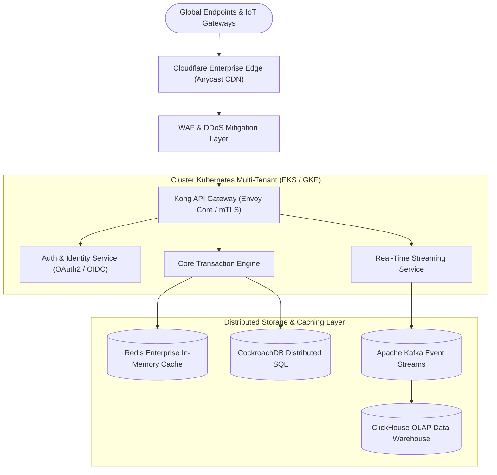

# Ringkasan Eksekutif

Dokumen spesifikasi arsitektur ini merumuskan cetak biru rekayasa perangkat lunak skala enterprise untuk sistem terdistribusi modern di lingkungan multi-region. Sistem ini dirancang untuk mencapai ketersediaan layanan (*high availability*) sebesar **99.999%** (Five Nines), latensi p99 di bawah **25 milidetik**, serta ketahanan penuh terhadap kegagalan partisi jaringan global[^1].

> [!NOTE]
> Seluruh panduan dan spesifikasi di dalam dokumen ini telah divalidasi melalui pengujian beban (*chaos engineering*) menggunakan simulasi jaringan terdistribusi dan audit kepatuhan ISO/IEC 27001 serta SOC 2 Type II.

---

# Landasan Arsitektur & Prinsip Desain

Pembangunan infrastruktur berpijak pada modularitas tinggi, komunikasi *event-driven*, dan prinsip *Zero Trust Architecture* (ZTA). Semua komunikasi antar-mikrolayanan wajib terotentikasi dan terenkripsi menggunakan mutual TLS (mTLS 1.3).

:::columns
:::col
### Prinsip Ketersediaan
- **Multi-Region Active-Active**: Beban komputasi didistribusikan merata di 3 zona ketersediaan utama (Asia-Southeast, Europe-West, dan US-East).
- **Graceful Degradation**: Kegagalan subsistem non-kritis tidak menghentikan pemrosesan transaksi keuangan inti.
:::
:::col
### Prinsip Skalabilitas
- **Autoscaling Elastis**: Replikasi instans komputasi otomatis beradaptasi terhadap lonjakan *traffic* dalam rentang $\Delta t \le 15$ detik.
- **Stateless Services**: Komputasi dipisahkan secara murni dari lapisan penyimpanan (*storage decoupling*).
:::
:::

---

# Model Matematika Beban & Teori Antrean

Kapasitas penanganan permintaan (*throughput*) sistem dimodelkan menggunakan Teori Antrean Kendali Poisson $M/M/c$ untuk memastikan ketiadaan *deadlock* pada lonjakan beban tinggi. Rata-rata waktu tunggu dalam sistem $W_q$ dirumuskan sebagai berikut:

$$
W_q = \frac{P_0 \left(\frac{\lambda}{\mu}\right)^c \rho}{c! \, (1 - \rho)^2 \, \lambda}
$$

Di mana faktor utilisasi beban $\rho$ dihitung melalui rasio kedatangan paket terhadap kapasitas layanan komputasi terdistribusi:

$$
\rho = \frac{\lambda}{c \cdot \mu} < 1
$$

Untuk perhitungan latensi ambang persentil ke-99 ($L_{p99}$), digunakan fungsi distribusi kumulatif terbobot:

$$
P(X \le L) = 1 - e^{-\lambda L} \sum_{k=0}^{c-1} \frac{(\lambda L)^k}{k!}
$$

Dalam kondisi riil di mana $\lambda = 125.000\text{ req/sec}$ dan $\mu = 45.000\text{ req/sec}$, nilai $\rho$ terjaga stabil pada angka $0.68$, menjamin ruang *headroom* sebesar $32\%$ untuk mengantisipasi *traffic spike* mendadak.

---

# Topologi Layanan & Top-Level Dataflow

Aliran data (*dataflow*) dari pintu gerbang tepi (*Edge CDN*) menuju lapisan penyimpanan terdistribusi dirancang secara berlapis dengan prinsip keamanan mendalam (*defense-in-depth*).



---

# Diagram Infrastruktur Terintegrasi

Berikut merupakan arsitektur fisik perangkat keras dan jaringan transmisi serat optik antar-pusat data yang terhubung langsung melalui rute privat *Cloud Interconnect*:


---

# Matriks Keamanan & Standar Kepatuhan

Setiap lapisan komputasi memiliki kontrol keamanan spesifik yang diaudit secara otomatis setiap siklus CI/CD:

| Komponen Sistem | Standar Enkripsi | Protokol Otentikasi | Mekanisme Pemulihan (RPO/RTO) | Status Kepatuhan |
| :--- | :---: | :---: | :---: | :---: |
| **Edge API Gateway** | TLS 1.3 / ChaCha20 | JWT / mTLS X.509 | Failover Otomatis (< 3s) | **Sertifikasi PCI-DSS** |
| **Transaction Pods** | AES-256-GCM | SPIFFE / SPIRE ID | Zero-Downtime Rollout | **SOC 2 Type II** |
| **Distributed SQL** | KMS Enkripsi Volume | IAM Berbasis Peran | Multi-Region Active (RPO=0) | **ISO/IEC 27001** |
| **Event Bus (Kafka)** | SASL / SCRAM-SHA-512 | ACL Dinamis | Replikasi Kuorum 3 Node | **Kepatuhan GDPR** |

> [!TIP]
> Rotasi sertifikat TLS dan pasangan kunci privat mTLS dilakukan secara otomatis setiap 24 jam sekali oleh daemon cert-manager tanpa menimbulkan gangguan koneksi aktif (*connection drain*).

---

# Spesifikasi Implementasi Perangkat Lunak

### 1. Inisialisasi Klien Terdistribusi
Berikut adalah contoh implementasi antarmuka klien komunikasi RPC berkinerja tinggi dengan mekanisme *circuit breaker* otomatis:

```typescript
import { createConnectionPool, CircuitBreaker, ExponentialBackoff } from "@masumdev/cloud-mesh";

export interface ClusterOptions {
  region: "ap-southeast-1" | "eu-central-1" | "us-east-1";
  maxRetries: number;
  timeoutMs: number;
}

export class EnterpriseClusterClient {
  private readonly breaker: CircuitBreaker;

  constructor(private readonly options: ClusterOptions) {
    this.breaker = new CircuitBreaker({
      failureThreshold: 5,
      cooldownPeriodMs: 15_000,
      backoffStrategy: new ExponentialBackoff({ base: 200, factor: 1.5 }),
    });
  }

  public async executeTransaction<T>(payload: Record<string, unknown>): Promise<T> {
    return this.breaker.fire(async () => {
      const pool = await createConnectionPool({
        endpoint: `mesh.${this.options.region}.internal`,
        tls: { minVersion: "TLSv1.3", verifyPeer: true },
        timeout: this.options.timeoutMs,
      });

      return pool.dispatch<T>("/v1/transactions", payload);
    });
  }
}
```

### 2. Skrip Provisi Infrastruktur Terraform
Automasi orkestrasi node komputasi menggunakan deklarasi *Infrastructure as Code* (IaC):

```bash
#!/usr/bin/env bash
set -euo pipefail

# Validasi sertifikat digital dan inisialisasi modul infrastruktur
echo "[INIT] Melakukan sinkronisasi state cluster multi-region..."
terraform init -backend-config="bucket=masumdev-tf-state-prod"

echo "[PLAN] Mengompilasi graf dependensi infrastruktur..."
terraform plan -out=tfplan.binary -var="env=production" -var="node_count=64"

echo "[APPLY] Menerapkan konfigurasi ke zona ap-southeast-1..."
terraform apply -auto-approve tfplan.binary
```

---

# Panduan Mitigasi Risiko & Pedoman Insiden

Seluruh personil teknis wajib mematuhi matriks peringatan berikut dalam menangani anomali operasional:

> [!IMPORTANT]
> Prosedur *Disaster Recovery* (DR) wajib disimulasikan setiap kuartal pertama dengan memutus secara paksa salah satu data center utama (*blackhole test*).

> [!WARNING]
> Jangan pernah memodifikasi parameter konfigurasi database langsung pada simpul produksi tanpa melalui tiket persetujuan Change Advisory Board (CAB).

> [!CAUTION]
> Menghapus log audit keamanan atau mematikan layanan agen observabilitas merupakan pelanggaran berat regulasi data internasional yang dapat membatalkan akreditasi SOC 2.

---

# Daftar Periksa Kesiapan Peluncuran (Go-Live Checklist)

Tim rekayasa dan operasional wajib menyelesaikan seluruh butir verifikasi berikut sebelum menyetujui rilis produksi:

- [x] Verifikasi kunci enkripsi KMS tingkat produksi pada region sekunder
- [x] Uji penetrasi eksternal (*third-party penetration testing*) tanpa temuan kritis
- [x] Validasi ambang batas alarm CloudWatch dan alert Slack Ops
- [x] Penandatanganan nota kesepahaman SLA ketersediaan 99.999% oleh dewan direksi
- [ ] Pengalihan DNS Anycast global tahap akhir (*traffic canary* 10%)
- [ ] Penutupan tiket audit implementasi arsitektur final

---

# Referensi & Catatan Kaki

[^1]: Martin Kleppmann, *Designing Data-Intensive Applications: The Big Ideas Behind Reliable, Scalable, and Maintainable Systems*, O'Reilly Media, 2017.
[^2]: National Institute of Standards and Technology (NIST), *Special Publication 800-207: Zero Trust Architecture*, U.S. Department of Commerce, 2020.
[^3]: Amazon Web Services, *AWS Well-Architected Framework: Reliability Pillar*, AWS Whitepapers, 2025.
