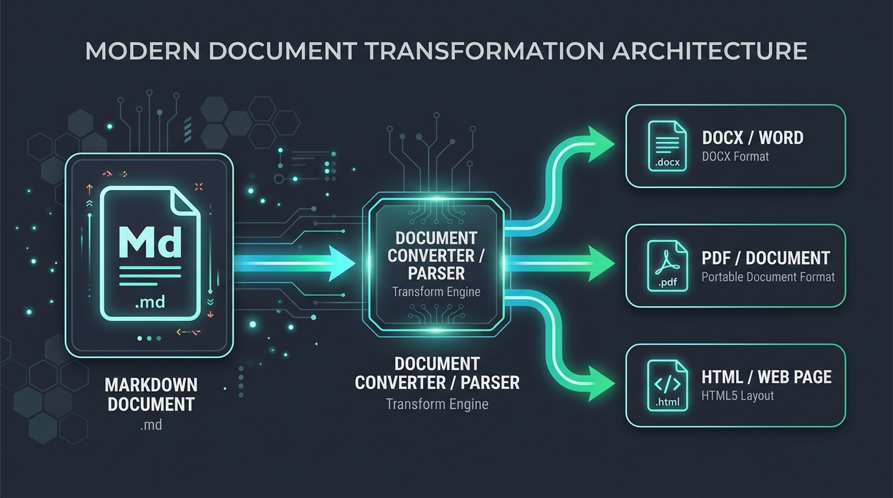
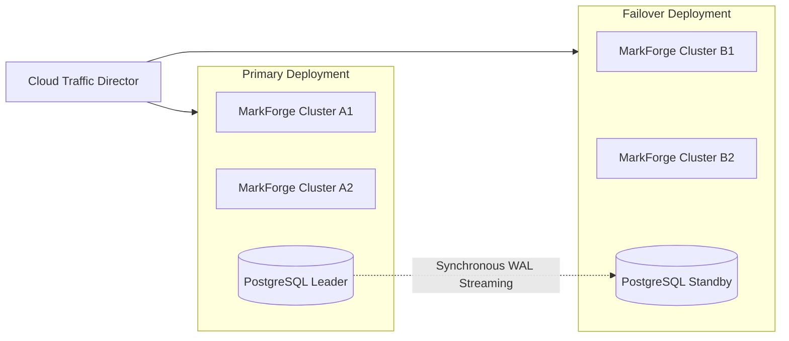

# 1. Scope of Agreement & Parties

This Master Services Agreement ("Agreement") governs the provisioning of enterprise-grade publishing infrastructure, cloud microservices, and high-availability document conversion pipelines provided by **{{company}}** to authorized institutional enterprise clients.

---

# 2. Service Level Objectives (SLO) & Availability

The service provider guarantees an operational monthly service availability uptime ratio $A_{\text{uptime}}$ of no less than **99.99%** ("Four Nines"):

$$A_{\text{uptime}} = \left( 1 - \frac{T_{\text{unplanned\_downtime}}}{T_{\text{total\_calendar\_minutes}} - T_{\text{scheduled\_maintenance}}} \right) \times 100\%$$

### Penalty Credit Allocation Matrix

| Monthly Uptime Percentage | SLA Service Credit Rebate | Incident Response Target | Root Cause Analysis (RCA) |
| :--- | :---: | :---: | :---: |
| **$\ge 99.99\%$** | 0% (Standard Operational Benchmark) | $< 15\text{ minutes}$ | N/A |
| **$99.90\% - 99.98\%$** | 10% Monthly Service Billing Credit | $< 10\text{ minutes}$ | Within 72 Hours |
| **$99.00\% - 99.89\%$** | 25% Monthly Service Billing Credit | $< 5\text{ minutes}$ | Within 48 Hours |
| **$< 99.00\%$** | 50% Monthly Service Billing Credit | Instant Executive Escalation | Within 24 Hours |

---

# 3. High-Availability System Architecture

Our multi-zone redundant cluster topology guarantees active-active failover with zero loss of document transaction logs:

---

# 4. Data Protection & Cryptographic Standards

:::columns 2
:::col
### Transport Layer Security
- **Encryption**: TLS 1.3 with ChaCha20-Poly1305 and AES-256-GCM cipher suites.
- **Certificate Rotation**: Automated 60-day short-lived X.509 issuance.
- **PFS**: Perfect Forward Secrecy enforced on all external endpoints.
:::col
### Document Encryption at Rest
- **PDF Security**: ISO 32000-2 AES-256 standard encryption.
- **Key Management**: FIPS 140-3 Level 3 Hardware Security Modules (HSM).
- **Access Control**: Role-based access control with biometric authorization.
:::
:::

---

# 5. Regulatory Compliance & Governance

> [!IMPORTANT]
> The publishing pipelines comply with SOC 2 Type II, ISO/IEC 27001:2022, HIPAA Security Rule, and GDPR Data Residency mandates.

> [!CAUTION]
> Unauthorized distribution, export, or cryptographic alteration of this master document without explicit written consent is strictly prohibited by law.
